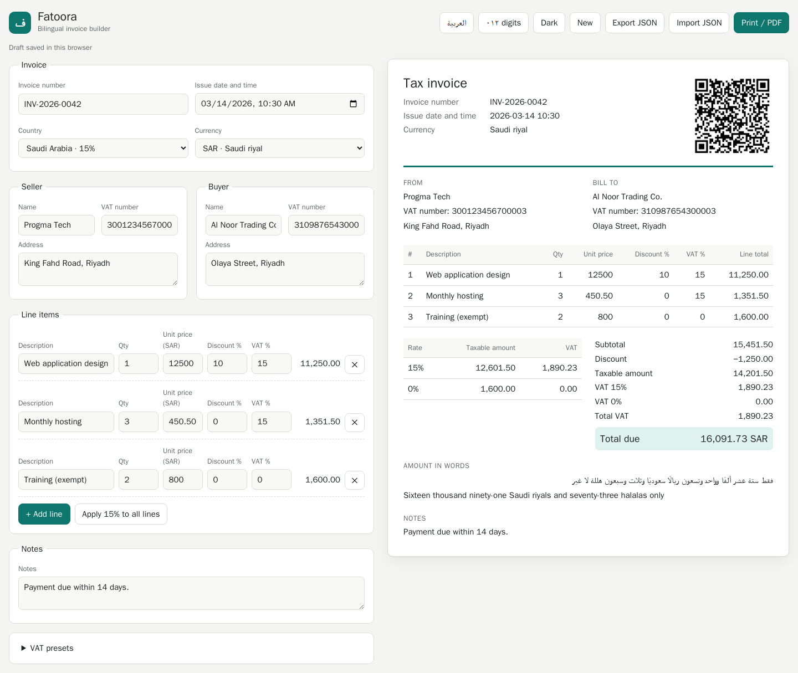
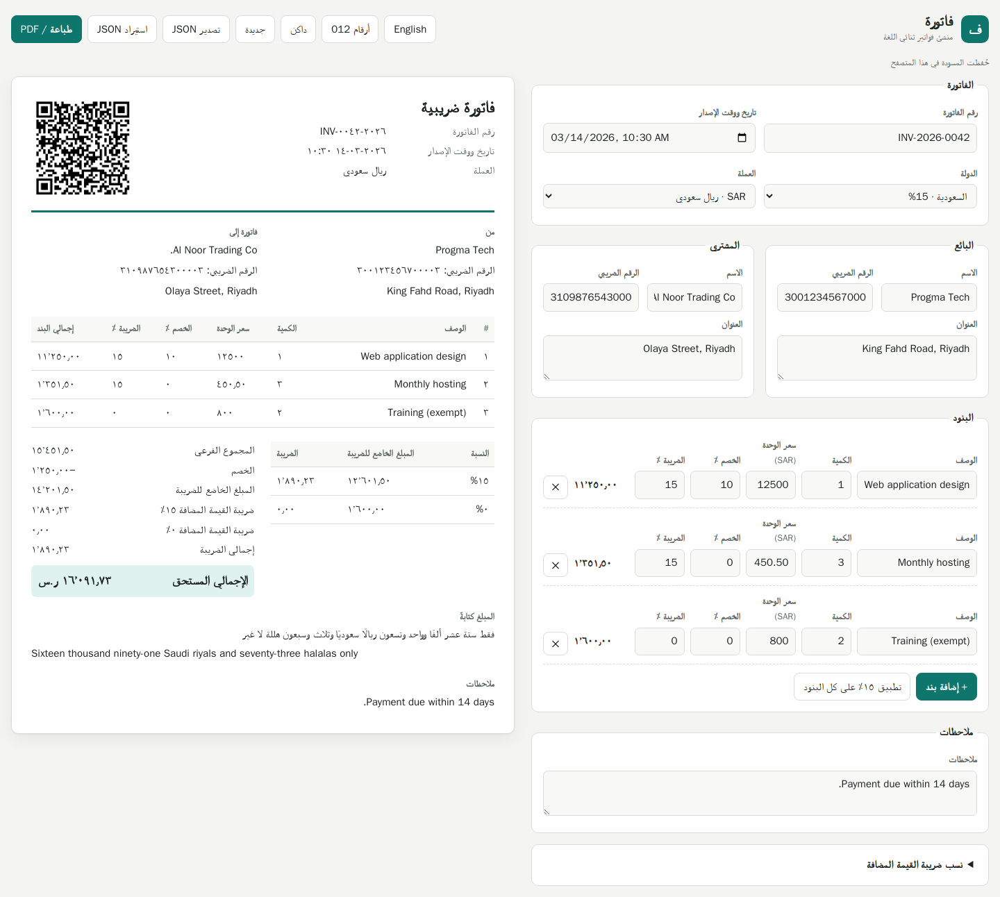
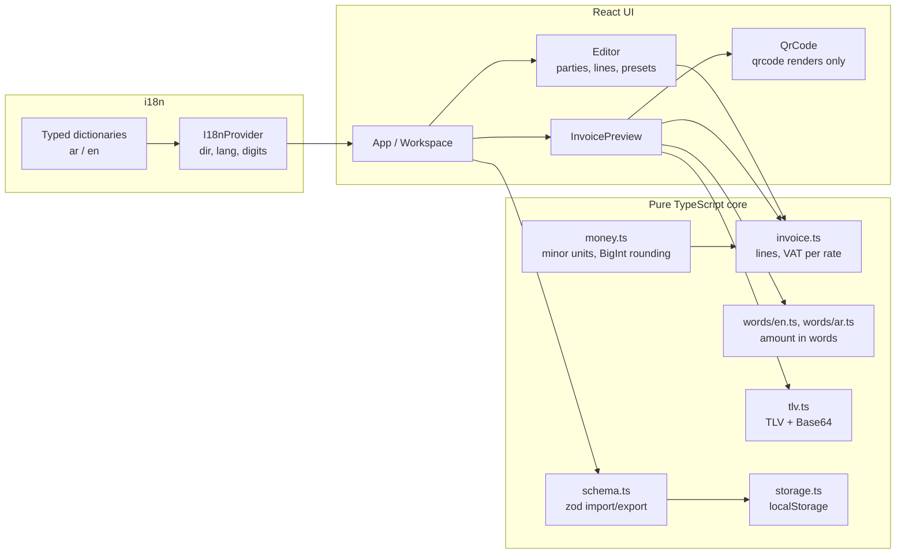

# Fatoora · فاتورة

A bilingual Arabic/English invoice builder for Gulf businesses. It runs entirely in the browser:
no server, no account, no data leaves the machine.

Fatoora handles the details that generic invoice templates get wrong for the region: right-to-left
layout, three-decimal currencies (BHD, KWD, OMR), VAT broken down per rate, amounts spelled out
in correct Arabic and English, and a QR code carrying the seller and totals.

## Screenshots



English view with a sample Saudi invoice (SAR, 15% and 0% lines): per-rate VAT breakdown, totals, amount in words and the TLV QR code. The names and numbers are made-up demo data.



The same invoice in Arabic with Arabic-Indic digits. The whole layout mirrors because it is built from logical CSS properties.

## Why

Freelancers and small firms in the Gulf often need an invoice that reads properly in both Arabic
and English, uses the right number of decimals for the currency, and shows VAT clearly. Spreadsheet
templates usually break on RTL, round money with floating point, and spell amounts only in
English. Fatoora is a small, auditable tool that gets those parts right.

## Features

- **Arabic and English UI** with full RTL/LTR switching: `dir` and `lang` on `<html>`, a layout
  built only from logical CSS properties, so everything mirrors.
- **Typed dictionaries** for `ar` and `en`, written in-house (no i18n library). A missing key is
  a compile error.
- **Seller, buyer and line items**: quantity, unit price, discount % and VAT rate per line.
- **Currencies**: QAR, AED, SAR, BHD, KWD, OMR and USD with their real minor units (3 decimals
  for BHD, KWD and OMR).
- **Integer money math**: amounts are stored and computed in minor units; no float rounding bugs.
- **VAT presets per country** (SA 15%, AE 5%, BH 10%, OM 5%, QA 0%, KW 0%), editable and saved.
- **Totals with a per-rate VAT breakdown.**
- **Arabic-Indic digits** (٠١٢٣) as a display option; numeric fields also accept them when typed.
- **Amount in words** in Arabic and English, implemented from scratch, including Arabic
  dual/plural/accusative forms and gender agreement for minor units (halala, baisa).
- **QR code** with a TLV QR payload in the format used for simplified tax invoices (seller name,
  VAT number, timestamp, total, VAT total), Base64 encoded.
- **Print stylesheet** for clean A4 output; use the browser's "Save as PDF".
- **Drafts** saved to `localStorage`; **JSON export/import** validated with zod.
- **Light and dark themes** via CSS variables. Handwritten CSS, no UI kit.

## Architecture



All business logic lives in `src/lib` as plain functions with no React or DOM dependencies, which
keeps it easy to test and to reuse elsewhere.

```
src/
  lib/            money, invoice totals, words (ar, en), TLV, digits, schema, storage
  i18n/           dictionaries, context, provider
  components/     editor fields, line items, VAT presets, preview, QR
  App.tsx         state, toolbar, layout
  index.css       theme variables, logical layout, print rules
```

## Quick start

Requires Node.js 20.19+ or 22.12+ (CI uses Node 24).

```bash
npm ci
npm run dev
```

Open the printed local URL. To produce a PDF, click **Print / PDF** and choose "Save as PDF".

## Scripts

| Script                 | What it does                                   |
| ---------------------- | ---------------------------------------------- |
| `npm run dev`          | Start the Vite dev server                      |
| `npm run build`        | Type-check and build to `dist/`                |
| `npm run preview`      | Serve the production build locally             |
| `npm test`             | Run Vitest in watch mode (`-- --run` for once) |
| `npm run lint`         | ESLint (flat config, typescript-eslint)        |
| `npm run format`       | Format with Prettier                           |
| `npm run format:check` | Check formatting without writing               |
| `npm run typecheck`    | `tsc -b` in strict mode                        |

## Design decisions

**Integer money.** Every amount is an integer count of minor units (fils, halala, baisa, cents).
Inputs are kept as the decimal strings the user typed and parsed directly into scaled integers,
never through `parseFloat`. Quantities are scaled by 1,000 and percentages by 100 (basis points).
Multiplications that need rounding go through `BigInt` and round half away from zero, so
`0.1 + 0.2` is exactly `0.3` and a 1.255 BHD price never drifts.

**VAT rounded per rate.** Line net amounts are summed per VAT rate and the rate is applied once to
each sum. The breakdown table and the grand total therefore always agree.

**Logical CSS.** The stylesheet uses `margin-inline`, `padding-block`, `inset-inline-start`,
`text-align: start/end` and friends instead of left/right. Switching `dir` on `<html>` mirrors
the whole layout with no RTL override file.

**Own i18n.** The English dictionary defines the key set; the Arabic one is typed against it, so
TypeScript reports any missing translation. Interpolation is a ten-line function.

**Own number-to-words.** The Arabic converter handles the parts of the grammar that matter on an
invoice: gender polarity for 3-10, dual forms (ريالان قطريان), plural after 3-10
(ثلاثة ريالات), accusative singular after 11-99 (خمسة عشر ريالًا), the same rules for thousands
and millions, and construct forms such as مائتا ألف.

**Own TLV encoder.** Each field is one tag byte, one length byte (UTF-8 byte count, so Arabic names
are measured correctly) and the value. The `qrcode` package is used only to draw the image.

## Limitations

- **Not tax advice and not certified.** Fatoora produces a TLV QR payload in the format used for
  simplified tax invoices, but it does not sign invoices, generate XML, or integrate with any
  tax authority platform. Check rates and invoice requirements with a qualified adviser.
- VAT presets are defaults that can change; they are editable for that reason.
- Amounts in words go up to the trillions; Arabic output is the nominative form used on invoices
  and cheques, not a full grammatical case engine.
- Drafts live in one browser's `localStorage`. Export JSON to keep a copy.

## Running tests

```bash
npm test -- --run
```

The suite covers money parsing and rounding for 2- and 3-decimal currencies, VAT breakdowns,
English and Arabic number-to-words (1, 2, 11, 100, 1,000, 2,000, 1,000,000 and minor units),
TLV encoding against a hand-computed Base64 string, digit conversion, import validation, and
component tests for the RTL toggle and live totals.

## ملخص بالعربية

**فاتورة** أداة مفتوحة المصدر لإنشاء الفواتير باللغتين العربية والإنجليزية، تعمل بالكامل داخل
المتصفح دون خادم. تدعم الاتجاه من اليمين إلى اليسار، وعملات الخليج (الريال القطري والدرهم
الإماراتي والريال السعودي والدينار البحريني والدينار الكويتي والريال العماني) مع ثلاث خانات عشرية
للدينار والريال العماني، وحساب المبالغ بأعداد صحيحة لتجنّب أخطاء الكسور، ونسب ضريبة القيمة
المضافة لكل دولة قابلة للتعديل، وكتابة المبلغ بالحروف بالعربية والإنجليزية، ورمز QR بصيغة TLV
المستخدمة في الفواتير الضريبية المبسطة، والطباعة إلى PDF، والأرقام الهندية (٠١٢٣).

هذه الأداة ليست استشارة ضريبية ولا حلًا معتمدًا لدى أي جهة رسمية.

## Author and licence

Built by Ahmed Mahdy. Released under the [MIT License](LICENSE).
